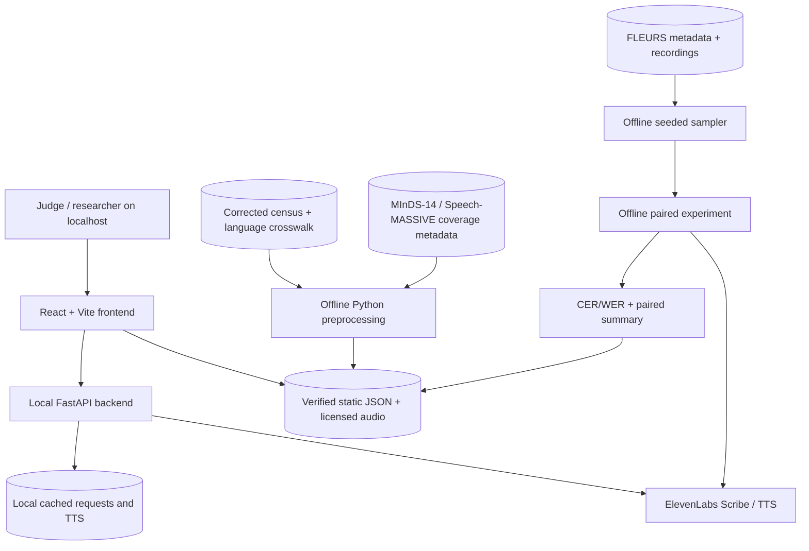
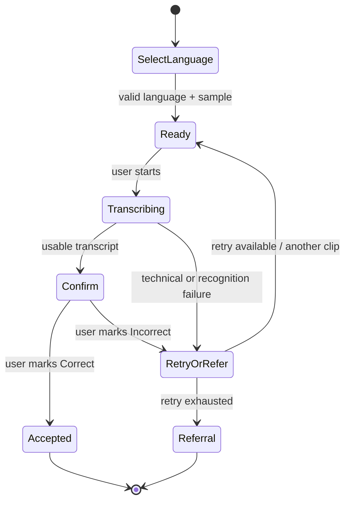

# Architecture — localhost-first research prototype

**Status:** approved *design*, not running code. See D-016, D-017, D-021 and D-025.

## Context / trust boundaries

**Boundary:** the frontend reads published/exported research JSON directly; it must not send private API keys or unrestricted local filesystem paths to FastAPI. FastAPI may use environment secrets; preprocessing accesses the large data archive only in developer-controlled local workspaces.

## Subsystems

1. **Offline census pipeline** (`scripts/`): read corrected ward file, language crosswalk, coverage file; join by canonical language ID, validate 11 wards, distinguish missing request audio from unavailable experimental measurements; export `wards.v1.json`, `languages.v1.json`, `recommendations.v1.json`.
2. **Offline speech pipeline** (`scripts/`): use six confirmed languages and eight seeded common FLEURS IDs; preflight real Scribe parameter and language hint support; make up to 96 transcription requests, cache each successful response with provenance; normalize texts, calculate CER and optional WER; export `samples.v1.json`, `experiments.v1.json` and summary. Do not overclaim n=8.
3. **Frontend** (`frontend/src`): one global selection state (`language_id`, `ward_id?`, `map_metric`), four named feature modules, full keyboard/empty-state support, static fallback when local backend is down.
4. **Backend** (`backend/app`): restricted file-by-ID transcription API, speech prompt endpoint, deterministic recovery state machine, explicit errors and bounded retry. No 311 connection or automatic intent execution.
5. **Dev/test infrastructure**: reproducible script entry points and fixtures, pytest/Vitest, local smoke test, GitHub Actions (not required to deploy).

## Data ownership and joining

| Data | Join key | Allowed inference | Forbidden inference |
|---|---|---|---|
| Ward census × language coverage | canonical `language_id` plus ward number | number/share of home-language speakers in selected ward | recognition performance of ward residents |
| FLEURS × Scribe output | `sample_id`, `language_id`, `fleurs_id` | per-clip transcription error for a given recording | city or ward-wide ASR failure rate |
| Coverage × experiment summary | `language_id` | compare evidence presence and *separate* measured pilot performance | missing request audio means unsupported by ElevenLabs |
| Recommendation × census | `language_id`, `ward_id` | where *recruitment for future study* might focus | geographic placement of real FLEURS speakers |

## Fixed and optional runtime components

- Required locally: Python, Node, React/Vite, FastAPI (for voice demo when available), corrected data, JSON outputs, prerecorded clips.
- No database, auth, Cloudflare, GitHub Pages, third-party public API server, conversational Agent, or mic permission required for hackathon.
- After the event, Cloudflare Pages may host static React; **cannot run Python FastAPI by itself**. Plan secure public API hosting separately before enabling public live-transcribe endpoints.

## Recovery state machine

- State should carry `session_id`, `language_id`, `sample_id`, `transcript`, `attempts`, `max_attempts=2` total attempts, status and provenance (`live` vs `saved`).
- A request can be *accepted* only by an explicit user confirmation; do not infer acceptance from STT confidence.
- Retry for prerecorded third-party speech is a **simulation** using a different clip; mark it as such. Technical failures do not certify a transcription error.
- Endpoint request/response examples are **proposals**, not pre-existing API definitions; see `DATA_CONTRACTS.md`.

## Graceful degradation order

1. No ElevenLabs connection: keep static map, experimental results, and cached authentic audio/voice prompts running.
2. No generated voice available: display text confirmation, label voice unavailable; do not misrepresent as a TTS success.
3. Missing guided model support: save `unsupported`; do not silently rerun in automatic mode.
4. Missing polygons or label mismatch: show ward chart with verified values and an explicit mapping warning.
5. Missing result for language: display `not_tested`; numeric error/accuracy absent (`null`), never zero.

## Interfaces and module responsibility

| Component | Consumes | Produces |
|---|---|---|
| Census/coverage scripts | supplied CSVs | `languages.v1.json`, `wards.v1.json`, `recommendations.v1.json` |
| Experiment runner | sample manifest, local FLAC, env secret | raw response cache + outcomes |
| Metrics script | normalized/reference/raw outcomes | `experiments.v1.json` and summaries |
| Frontend map | ward polygons, `wards.v1.json`, selection | selected ward, count/share view |
| Frontend speech lab | `samples.v1.json`, `experiments.v1.json`, permitted audio | displayed transcripts and comparisons |
| Frontend recovery | local backend; cached fallback | displayed confirmation / retry / referral |

## Feature and release checkpoints

- **A:** one authentic Urdu recording and one valid ward shown end-to-end.
- **B:** four MVP modules integrated; all available six-language pilot results or explicitly incomplete status.
- **C:** local demo works from clean start and with simulated network outage; no unsupported results presented as verified.
